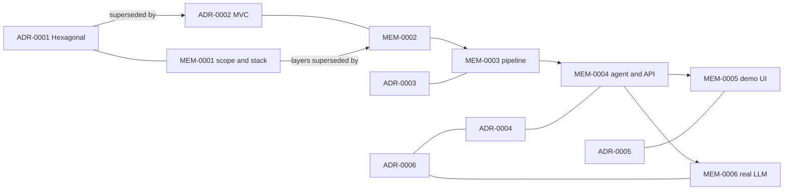

# Decision Index

This index lists every decision record. Add a row when you add a record. A test checks that each record is listed.
Records are in three places: ADR (`docs/adr/`), MEM (`.agents/memories/`) and ERR (`.agents/errors/`).

## Architecture Decision Records (ADR)

| ID | Title | Status | Date |
| --- | --- | --- | --- |
| ADR-0001-hexagonal-with-swappable-adapters.md | Hexagonal architecture with swappable adapters | Superseded by ADR-0002-lightweight-mvc.md | 2026-10-27 |
| ADR-0002-lightweight-mvc.md | Lightweight MVC | Accepted | 2026-10-28 |
| ADR-0003-mqtt-topics-demo-clock-single-table.md | MQTT topics, demo clock, single-table DynamoDB | Accepted | 2026-10-28 |
| ADR-0004-offline-agent-and-http-api.md | Offline agent, tools behind a policy, idempotent HTTP | Accepted | 2026-10-28 |
| ADR-0005-streamlit-demo-ui.md | Streamlit demo UI over the HTTP API | Accepted | 2026-10-28 |
| ADR-0006-real-llm-providers.md | Real LLM providers behind a factory, with an offline fallback | Accepted | 2026-10-29 |

## Memory records (MEM): what to know when you work on a part

| ID | Topic | Status |
| --- | --- | --- |
| MEM-0001-poc-scope-and-stack.md | Scope, environment, stack, workflow | Approved (layer decision superseded) |
| MEM-0002-mvc-architecture.md | Packages and import rules | Approved |
| MEM-0003-phase-2-data-pipeline.md | Topics, payloads, table layout, scenarios | Approved |
| MEM-0004-phase-3-agent-and-api.md | Tools, policy, prompt contract, HTTP API | Approved |
| MEM-0005-phase-4-demo-ui.md | Page, demo endpoints, rehearsal | Approved |
| MEM-0006-real-llm-providers.md | Providers, variables, evaluation, limits | Approved |

## Error records (ERR): problems that cost time

| ID | Severity |
| --- | --- |
| ERR-20261027-compose-run-build-flag.md | Medium |
| ERR-20261028-test-container-missing-docs.md | Medium |
| ERR-20261028-streamlit-emoji-icon.md | Medium |

## How the records relate

## Rules for new records

- An ADR has: Context, Decision, Alternatives Considered, [Trade-off Analysis], Consequences, Verification.
- A MEM has: Summary, Context & Evolution, Specification, When to Use.
- If a record replaces another, write the link in both records. A test checks that links are two-way.
- Use the full file name when you refer to another record.
