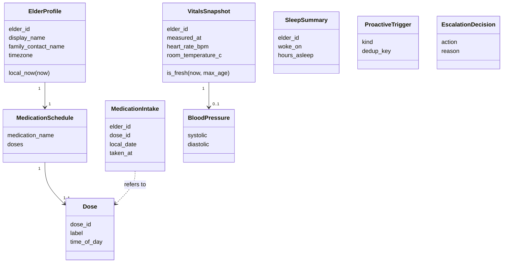
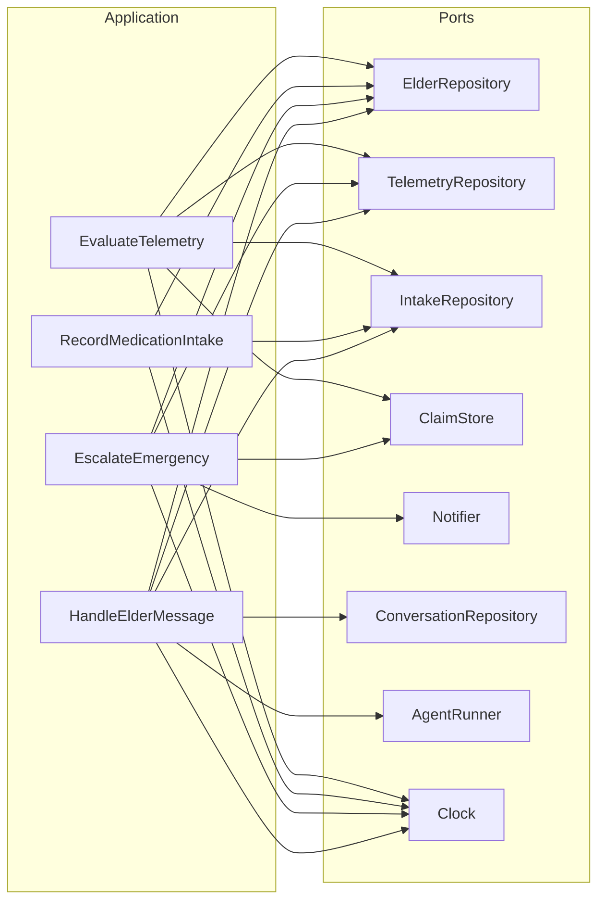

# Domain Model and Layers

Status: Phase 1. Update this file before you change the Domain layer.

## Domain classes

## Domain rules (pure functions, no I/O)

| Function | Input | Output |
| --- | --- | --- |
| `assess_blood_pressure` | BloodPressure, thresholds | AlertLevel (LOW, NORMAL, ELEVATED, HIGH, CRITICAL) |
| `decide_escalation` | AlertLevel or None, symptoms | EscalationDecision (NONE, NOTIFY_FAMILY, CALL_EMERGENCY) |
| `dose_states` | schedule, taken dose ids, local time | state per dose (UPCOMING, DUE, TAKEN, MISSED) |
| `resolve_intake` | schedule, taken dose ids, local time | which dose to record, or ALREADY_TAKEN, or NO_DOSE_DUE |
| `evaluate_triggers` | local time, schedule, vitals, sleep | list of ProactiveTrigger |

All thresholds are demo values. A clinician must review them before real use.

## Use cases and ports

## Impact notes

- Phase 1 is new code. No upstream or downstream code exists yet.
- Phase 2 adds DynamoDB and MQTT adapters. They must pass the same port contracts as the in-memory adapters.
- Phase 3 adds the agent tools. Each tool calls one use case. No tool calls a repository directly.
