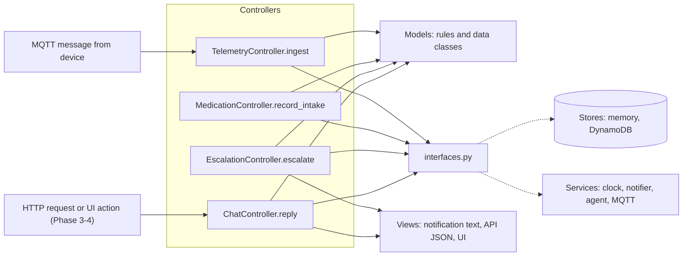
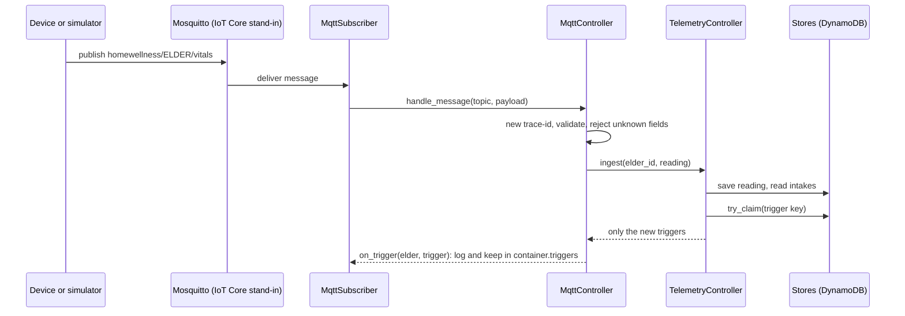
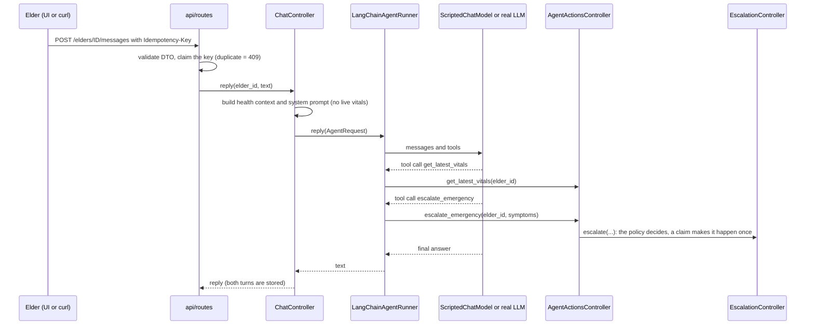
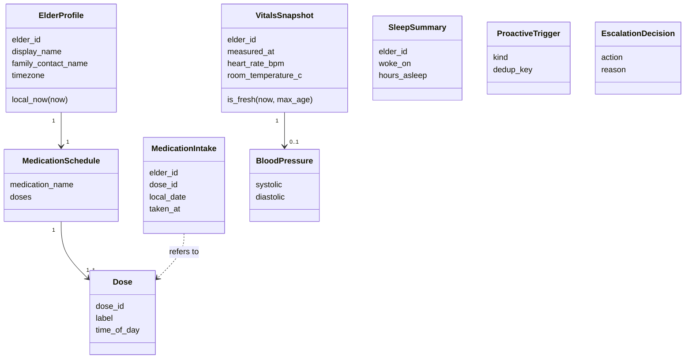

# MVC Architecture Overview

Status: Phase 4. Update this file before you change a model.
Replaces: the DDD layer model (Domain, Application, Infrastructure). See ADR-0002.

## Packages

| Package | MVC role | Content | May import |
| --- | --- | --- | --- |
| `models/` | Model | Data classes and business rules. Pure code. No I/O. | standard library only |
| `stores/` | Model (data access) | One store per kind of data. In-memory and DynamoDB versions. | `models` |
| `services/` | Model (outside world) | Clock, notifier, MQTT client, LangChain agent runner, scripted model, activity log. | `models`, `interfaces` |
| `controllers/` | Controller | Take an input, call models, stores and services, return a result. | `models`, `views`, `interfaces` |
| `views/` | View | Text and format for people. Later: API JSON and the Streamlit page. | `models` |
| `interfaces.py` | Seams | Small Protocols for what we may swap: stores, clock, notifier, agent. | `models` |
| `observability.py` | Support | JSON logs with trace-id and user-id. | standard library |
| `bootstrap.py` | Wiring | Builds the real objects and gives them to the controllers. | everything |
| `ui/` (outside `src/`) | View (browser) | Streamlit page. It uses the HTTP API only, through `api_client.py`. Own image and tests. | the HTTP API |
| `api/` | Controller + View (HTTP) | FastAPI routes, strict DTOs, trace-id, sanitized errors. | `controllers`, `views`, `models`, `interfaces` |
| `settings.py`, `main.py` | Wiring | Environment settings and the production entry point. | `bootstrap`, `api`, `services` |
| `topics.py` | Support | MQTT topic names. The device, the simulator and the controller share them. | standard library |
| `demo.py`, `simulator/` | Demo | Demo elder, three scenarios, and the CLI that plays them. | `models`, `topics` |

A controller never imports a concrete store or service. `bootstrap.py` does it.
`tests/unit/test_architecture_rules.py` checks these rules.

## Flow

## Device message flow (Phase 2)

In demo mode the topic `homewellness/sim/clock` moves the worker clock. Each scenario starts with one
clock message. In normal mode the worker ignores it.

## DynamoDB table layout (single table, keys PK and SK, JSON text in `data`)

| PK | SK | Content |
| --- | --- | --- |
| `ELDER#<id>` | `VITALS#<utc time>` | one reading |
| `ELDER#<id>` | `SLEEP#<woke_on date>` | summary of the last night |
| `ELDER#<id>` | `INTAKE#<date>#<dose_id>` | one dose taken. A conditional write stops a double record. |
| `ELDER#<id>` | `TURN#<utc time>#<random>` | one conversation turn |
| `CLAIM#<key>` | `CLAIM` | idempotency and de-duplication key |

## Agent flow (Phase 3)

A device event starts the same flow without an elder message:
`MqttController -> Container.handle_triggers -> ChatController.proactive -> agent -> stored agent turn`.

### Tools (each is bound to one elder; no tool takes an elder id)

| Tool | Calls | Effect |
| --- | --- | --- |
| `get_latest_vitals` | current vitals and level | read only |
| `get_medication_status` | `MedicationController.status` | read only |
| `log_medication_intake` | `MedicationController.record_intake` | writes one intake (atomic) |
| `escalate_emergency` | `EscalationController.escalate` | the policy may refuse. One alert per 10 minutes. |

### Memory

- Short term: the last 10 turns (`ConversationStore`).
- Long term: intakes, sleep and vitals in the stores. The system prompt carries the brief: name, family,
  time, medicine and dose states, last night's sleep.
- Live blood pressure is not in the prompt. The agent must call a tool for it.

## HTTP API (see `docs/api/openapi.yaml`)

| Method and path | Purpose | Idempotency-Key |
| --- | --- | --- |
| `POST /elders/{id}/messages` | the elder says something | required (duplicate = 409) |
| `GET /elders/{id}/conversation` | the last turns | - |
| `GET /elders/{id}/status` | vitals, level, sleep, doses | - |
| `GET /alerts` | alerts that were sent | - |
| `POST /sim/scenarios/{name}` | demo only: publish a scenario to MQTT | required |
| `GET /demo/activity` | demo only: clock, device, trigger, tool and alert events | - |
| `POST /demo/reset` | demo only: forget all data, move the clock back | required |
| `GET /healthz` | 200 when connected to the broker and subscribed | - |

Errors use one shape: `{"error": {"code", "message", "trace_id"}}`. No stack trace and no input value.

## Model classes

## Model rules (pure functions)

| Function | Input | Output |
| --- | --- | --- |
| `assess_blood_pressure` | BloodPressure, thresholds | AlertLevel (LOW, NORMAL, ELEVATED, HIGH, CRITICAL) |
| `decide_escalation` | AlertLevel or None, symptoms | EscalationDecision (NONE, NOTIFY_FAMILY, CALL_EMERGENCY) |
| `dose_states` | schedule, taken dose ids, local time | state per dose (UPCOMING, DUE, TAKEN, MISSED) |
| `resolve_intake` | schedule, taken dose ids, local time | dose to record, or ALREADY_TAKEN, or NO_DOSE_DUE. Checks only the most recent recordable dose. |
| `evaluate_triggers` | local time, schedule, vitals, sleep | list of ProactiveTrigger |

All thresholds are demo values. A clinician must review them before real use.

## Concurrency contract (all stores)

- `IntakeStore.add` is atomic. It returns False if the dose is already stored for that date.
- `ClaimStore.try_claim` is atomic. Only the first caller gets True.
- `EscalationController` frees its claim when the notifier fails, so a retry can send the alert.

## Migration map (Phase 1b impact analysis)

| Before | After |
| --- | --- |
| `domain/*` | `models/*` (same files) |
| `application/models.py` | `models/interaction.py` |
| `application/ports.py` | `interfaces.py` (`*Repository` is now `*Store`) |
| `application/evaluate_telemetry.py` (`EvaluateTelemetry.execute`) | `controllers/telemetry.py` (`TelemetryController.ingest`) |
| `application/record_medication_intake.py` | `controllers/medication.py` (`MedicationController.record_intake`) |
| `application/escalate_emergency.py` | `controllers/escalation.py` (`EscalationController.escalate`) |
| `application/handle_elder_message.py` | `controllers/chat.py` (`ChatController.reply`) |
| `application/health_context.py` | `controllers/health_context.py` |
| `application/messages.py` | `views/notifications.py` |
| `infrastructure/in_memory.py` | `stores/memory.py`, `services/clock.py`, `services/notifier.py` |

Behavior does not change. No outside code calls these modules yet. The 122 unit tests are the safety net.
