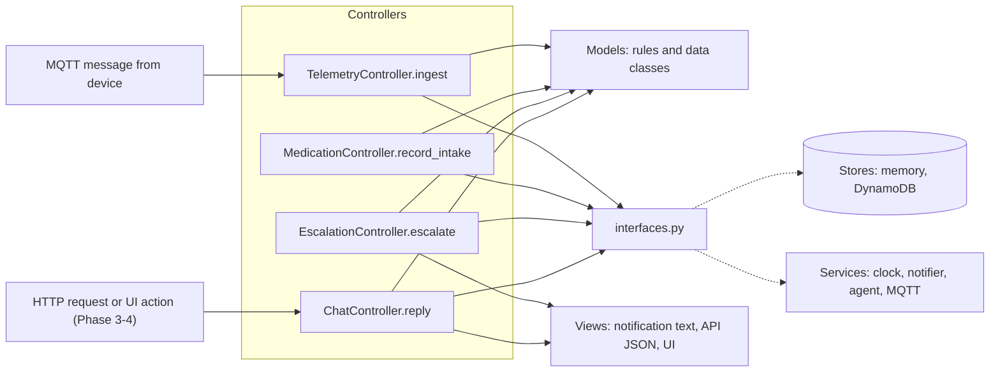
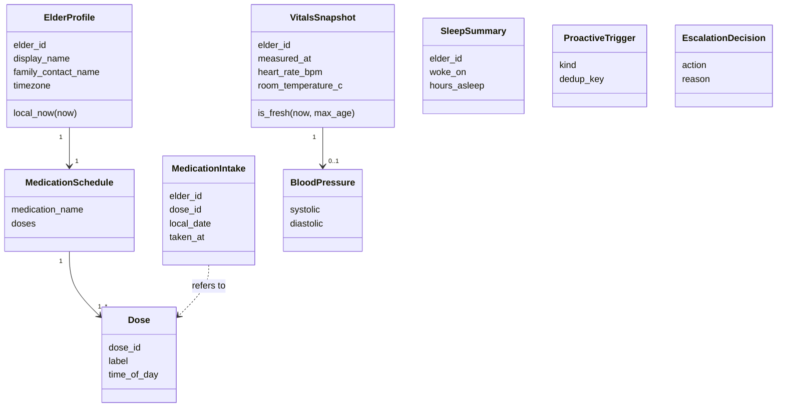

# MVC Architecture Overview

Status: Phase 1b. Update this file before you change a model.
Replaces: the DDD layer model (Domain, Application, Infrastructure). See ADR-0002.

## Packages

| Package | MVC role | Content | May import |
| --- | --- | --- | --- |
| `models/` | Model | Data classes and business rules. Pure code. No I/O. | standard library only |
| `stores/` | Model (data access) | One store per kind of data. In-memory and DynamoDB versions. | `models` |
| `services/` | Model (outside world) | Clock, notifier, MQTT client, agent brain. | `models`, `interfaces` |
| `controllers/` | Controller | Take an input, call models, stores and services, return a result. | `models`, `views`, `interfaces` |
| `views/` | View | Text and format for people. Later: API JSON and the Streamlit page. | `models` |
| `interfaces.py` | Seams | Small Protocols for what we may swap: stores, clock, notifier, agent. | `models` |
| `observability.py` | Support | JSON logs with trace-id and user-id. | standard library |
| `bootstrap.py` (Phase 2) | Wiring | Builds the real objects and gives them to the controllers. | everything |

A controller never imports a concrete store or service. `bootstrap.py` does it.
`tests/unit/test_architecture_rules.py` checks these rules.

## Flow

## Model classes

## Model rules (pure functions)

| Function | Input | Output |
| --- | --- | --- |
| `assess_blood_pressure` | BloodPressure, thresholds | AlertLevel (LOW, NORMAL, ELEVATED, HIGH, CRITICAL) |
| `decide_escalation` | AlertLevel or None, symptoms | EscalationDecision (NONE, NOTIFY_FAMILY, CALL_EMERGENCY) |
| `dose_states` | schedule, taken dose ids, local time | state per dose (UPCOMING, DUE, TAKEN, MISSED) |
| `resolve_intake` | schedule, taken dose ids, local time | dose to record, or ALREADY_TAKEN, or NO_DOSE_DUE. Checks only the most recent recordable dose. |
| `evaluate_triggers` | local time, schedule, vitals, sleep | list of ProactiveTrigger |

All thresholds are demo values. A clinician must review them before real use.

## Concurrency contract (all stores)

- `IntakeStore.add` is atomic. It returns False if the dose is already stored for that date.
- `ClaimStore.try_claim` is atomic. Only the first caller gets True.
- `EscalationController` frees its claim when the notifier fails, so a retry can send the alert.

## Migration map (Phase 1b impact analysis)

| Before | After |
| --- | --- |
| `domain/*` | `models/*` (same files) |
| `application/models.py` | `models/interaction.py` |
| `application/ports.py` | `interfaces.py` (`*Repository` is now `*Store`) |
| `application/evaluate_telemetry.py` (`EvaluateTelemetry.execute`) | `controllers/telemetry.py` (`TelemetryController.ingest`) |
| `application/record_medication_intake.py` | `controllers/medication.py` (`MedicationController.record_intake`) |
| `application/escalate_emergency.py` | `controllers/escalation.py` (`EscalationController.escalate`) |
| `application/handle_elder_message.py` | `controllers/chat.py` (`ChatController.reply`) |
| `application/health_context.py` | `controllers/health_context.py` |
| `application/messages.py` | `views/notifications.py` |
| `infrastructure/in_memory.py` | `stores/memory.py`, `services/clock.py`, `services/notifier.py` |

Behavior does not change. No outside code calls these modules yet. The 122 unit tests are the safety net.
